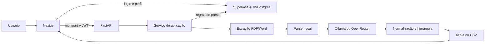

# Arquitetura

## Componentes

O frontend e o backend são aplicações independentes. O frontend autentica o usuário no Supabase e chama a API configurada por variável de ambiente. O backend usa uma chave privilegiada para consultar as regras do parser e não deve expor essa chave ao navegador.

## Fluxo da extração

1. O usuário entra com e-mail e senha no Supabase.
2. A tela de extração valida a extensão e mantém a ordem visual dos arquivos.
3. O frontend envia os arquivos como partes `files[]`, na ordem apresentada.
4. Quando há callback de progresso, o frontend gera um `X-Processing-Id` e consulta o endpoint de status a cada 1,25 segundo.
5. O backend valida quantidade e tamanho, extrai texto, tabelas e imagens e separa o conteúdo em blocos.
6. As regras ativas de `public.parser_rules` orientam a categoria e o tipo de tarefa de cada bloco.
7. Os blocos textuais são agrupados em lotes e enviados ao provedor LLM configurado.
8. O backend corrige cobertura, aplica fallbacks determinísticos, consolida a hierarquia e normaliza as colunas.
9. Imagens relevantes são preservadas como linhas informativas no XLSX.
10. A API devolve XLSX ou CSV. Se somente alguns lotes da IA falharem, devolve um arquivo parcial e sinaliza a condição nos headers.

## Responsabilidades

| Camada | Responsabilidade | Entrada/saída principal |
|---|---|---|
| Next.js | Sessão, fila, progresso e download | Arquivos do usuário e Blob retornado pela API |
| FastAPI/router | Validação HTTP, autenticação, erros e resposta | Multipart e XLSX/CSV |
| Serviço de aplicação | Orquestração do pipeline e progresso | Arquivos e linhas normalizadas |
| Extração | Leitura de PDF, DOC e DOCX | Bytes e blocos textuais/visuais |
| Parser local | Categoria, escopo, item e palavras-chave | Blocos estruturados |
| Supabase | Auth, perfil e regras configuráveis | JWT, perfil e `parser_rules` |
| LLM | Conversão semântica dos blocos | JSON validado da matriz |
| Pós-processamento | Granularidade, executante e hierarquia | Linhas finais normalizadas |

## Estado e escalabilidade

O progresso fica em memória no processo FastAPI e expira após uma hora. Reiniciar a API perde os estados em andamento. Múltiplas réplicas também exigiriam armazenamento compartilhado ou afinidade de sessão; o desenho atual é apropriado para uma única instância.

Os arquivos são processados durante a própria requisição. Não existe fila persistente, worker separado ou histórico de execuções.

## Caminho ativo

O endpoint atual usa `routers/extracao_pdf.py` somente como adaptador HTTP. A orquestração está em `extraction_pipeline_service.py`, que depende de contratos pequenos para carregar regras e converter blocos. Extração, classificação, regras, LLM, hierarquia, normalização e geração de arquivos permanecem em serviços próprios.

## Limitações conhecidas

- PDF sem camada de texto não possui OCR.
- O progresso não é persistente nem distribuído.
- O schema completo do Supabase ainda não possui migrations reproduzíveis no repositório.
- O frontend não possui suíte automatizada nem lint configurado.

